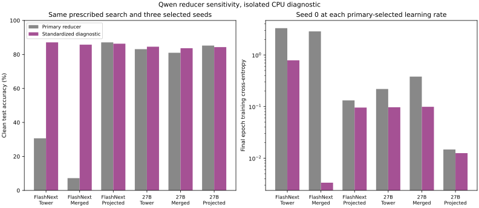
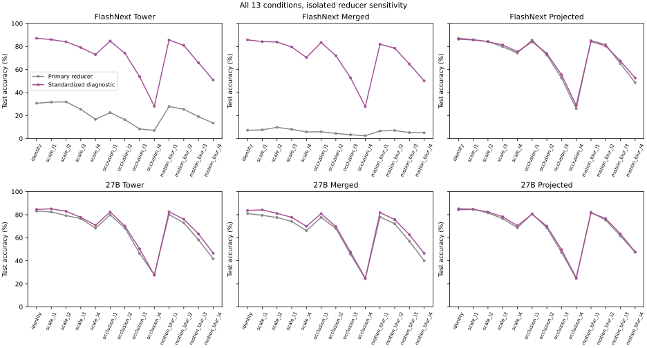

# Qwen perturbation reducer sensitivity

This isolated diagnostic covers both checkpoints, all three Stages, and all 13 conditions.
Every run uses the same CPU hardware, six threads, 1,400 training images, 300 validation
images, and 300 test images. The 11-rate search uses seed 0. The selected rate uses
seeds 0, 1, and 2 for 20 epochs, as in the primary protocol.

The only intervention is the reducer. Clean training tokens alone fit the FP32 channel
mean, sample standard deviation with correction 1 clamped at 1e-6, and seeded PCA.
The frozen reducer and readout then score every condition. No validation or test image
fits the reducer. The exact recovered R2 patch and its SHA256 are recorded in each
sensitivity payload. Primary file hashes match before and after execution.

| Checkpoint / Stage | Primary clean | Standardized clean | RMS max/median | PC1 primary | PC1 standardized |
|---|---:|---:|---:|---:|---:|
| FlashNext tower | 30.67% | 87.11% | 340.5 | 0.9990 | 0.7839 |
| FlashNext merged | 7.22% | 85.78% | 378.3 | 0.5511 | 0.4390 |
| FlashNext projected | 87.11% | 86.33% | 6.2 | 0.0807 | 0.0771 |
| 27B tower | 83.11% | 84.56% | 348.0 | 0.9900 | 0.4635 |
| 27B merged | 81.00% | 83.67% | 366.2 | 0.5564 | 0.2925 |
| 27B projected | 85.22% | 84.33% | 236.2 | 0.4445 | 0.0720 |





Standardization recovers the weak FlashNext Tower and merged clean readouts. This
establishes sensitivity to the measurement reducer under the recorded protocol.
Both checkpoints have concentrated Tower variance and large channel RMS ratios,
and their merged PC1 shares are similar. Those statistics alone do not explain why
the primary FlashNext readouts fail. This diagnostic does not establish a training
cause or the same cause as MiMo's readout failure.
The intervention changes channel scales and the retained PCA subspace. This run
does not separate their effects.

The loss comparison holds the seed and learning rate fixed at each primary-selected
rate. The standardized search contains that exact rate, so the plotted loss change
does not depend on selecting a different rate. Full batch and epoch histories, all
search outcomes, and every selected-seed outcome remain in the source payloads.

Four `paired-*.json` files compare standardized Projector against Tower and FlashNext
against fresh 27B at each Stage. Each interval uses its own paired correctness,
the same 300 test IDs, seed means, 10,000 image bootstrap draws, and 95% confidence.
`summary.json` retains these intervals and source hashes. These are diagnostic
comparisons. They do not replace primary measurements or the outstanding full suite.
Primary FlashNext Tower and merged perturbation results do not support intrinsic
robustness claims given their low clean accuracy.

Regenerate the report from the repository root:

```bash
CUDA_VISIBLE_DEVICES="" OMP_NUM_THREADS=6 MKL_NUM_THREADS=6 python -m scripts.qwen_conditioning_report \
  --directory results/diagnostics/qwen38-flash-next-conditioning \
  --flash-primary results/perturbation/qwen38_flash_next_perturbation.json \
  --control-primary results/evidence/qwen38-flash-next/controls/qwen3_5_perturbation.json
```

`channel-details.json` retains every training-channel mean, sample standard
deviation, clamped scale, and RMS value, together with exact fit IDs and cache hashes.
`execution-provenance.json` retains the original commands, source hashes,
device settings, start and end times, exit statuses, and output hashes. The hardware
record is `cpu-hardware.json`. The recovered patch is retained in the
[source evidence](../../evidence/qwen38-flash-next/reducer-channel-standardization.patch).
