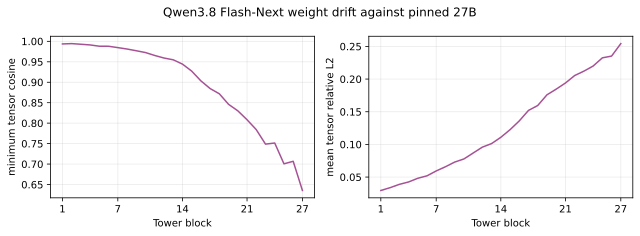

# Qwen3.8 Flash-Next source and release evidence

Source revision: `de4b8e4d43b917e7706784d8bb445c9af86a3540`.
Sibling 27B revision: `1d4bf0f2ff6012fd82039f2fa52739d0dd7c60c0`.
Published release revision: `120ed5d5baf11cb478099350e94218ee3cbed3df`.

All 333 BF16 tensors match the pinned source exactly. The independent parent
class is `Qwen4ExpVisionModel`; the release uses `Qwen3_5VisionModel`. Both
load strictly without adding a persistent buffer. CPU FP32, CPU BF16 and CUDA
BF16 match exactly at 96 and 448 pixels on two fixed images, for all eight
Tower depths and both Connector Stages. Each report records hashes and software
versions. A fresh immutable Hub download also passes the independent CPU BF16
check. All forward checks use zero absolute and relative tolerance.

The copied source LICENSE is Qwen Community License 1.0. Its SHA256 is
`a0dc422560841fd68e06d974907f8b4c709bca44a67daad2b528437bdf676c08`.

## Weight drift

Every one of the 331 shared-shaped tensors differs from 27B. The last
Projector weight and bias change output width from 5120 to 2560.
Tower and merged comparisons change weights only. Projected comparisons
also change output width. Low cosine alone does not establish whether a
layer was reinitialized. The per-tensor report retains every comparison.

The table reports minimum tensor cosine and mean tensor relative L2 within
each group. It does not concatenate tensors or weight by parameter count.
Relative L2 uses the 27B tensor norm as its denominator.

| Group | Comparable tensors | Minimum cosine | Mean relative L2 |
|---|---:|---:|---:|
| Patch embedding | 2 | 0.997942 | 0.034409 |
| Position embeddings | 1 | 0.967426 | 0.437639 |
| Block 1 | 12 | 0.993566 | 0.029494 |
| Block 2 | 12 | 0.994374 | 0.033765 |
| Block 3 | 12 | 0.992818 | 0.038825 |
| Block 4 | 12 | 0.991144 | 0.042491 |
| Block 5 | 12 | 0.988022 | 0.048138 |
| Block 6 | 12 | 0.987926 | 0.051917 |
| Block 7 | 12 | 0.984595 | 0.059397 |
| Block 8 | 12 | 0.981154 | 0.065827 |
| Block 9 | 12 | 0.976949 | 0.072966 |
| Block 10 | 12 | 0.972526 | 0.077746 |
| Block 11 | 12 | 0.965400 | 0.086813 |
| Block 12 | 12 | 0.959172 | 0.095836 |
| Block 13 | 12 | 0.954834 | 0.101286 |
| Block 14 | 12 | 0.944324 | 0.110885 |
| Block 15 | 12 | 0.927222 | 0.122553 |
| Block 16 | 12 | 0.903326 | 0.135996 |
| Block 17 | 12 | 0.884584 | 0.152066 |
| Block 18 | 12 | 0.871726 | 0.159564 |
| Block 19 | 12 | 0.845952 | 0.175936 |
| Block 20 | 12 | 0.830169 | 0.184637 |
| Block 21 | 12 | 0.808391 | 0.193974 |
| Block 22 | 12 | 0.784110 | 0.205426 |
| Block 23 | 12 | 0.748784 | 0.212161 |
| Block 24 | 12 | 0.751478 | 0.219950 |
| Block 25 | 12 | 0.700632 | 0.232516 |
| Block 26 | 12 | 0.706838 | 0.235200 |
| Block 27 | 12 | 0.635522 | 0.254294 |
| Projector | 4 | -0.137720 | 0.621019 |

## Benchmark status

The full 448-pixel suite is in progress. No benchmark point estimate or sibling
performance delta is claimed by this source and release evidence. The expected
inventory records the required coverage. Learning-rate selection uses seed 0
at every prescribed rate, followed by three seeds at the selected rate.

Reproduce source extraction and validation from the repository root:

```bash
python -m scripts.export_qwen3_8_vision --checkpoint qwen38_flash_next
python -m scripts.validate_qwen38_flash_next --out parity.json --drift-out drift.json
```

The full prepared-input SHA256 inventory is retained as
`prepared-data-sha256.txt.gz`. Paths describe the delivery environment.
`prepared-data-audit.json` records the shared preparation command's successful
completion and manifest hash. `checkpoint-audit.json` verifies the pinned
source indexes, configs, identical image and video preprocessing files, and
all shared architecture fields. The parent has LICENSE and no NOTICE.



The isolated standardized label-budget diagnostic follows the archived
`reducer-channel-standardization.patch` exactly. Its sample standard deviation
uses correction 1 and a minimum scale of 1e-6. It fits only on the labelled
training subset with the existing seeded PCA rule. Primary probes keep the
original reducer. The patch SHA256 is
`f5a2bc1dcda0e6be9a2d6abea9c1bcc9cb5817282ff6406489b5022dc65e330a`.

The final immutable reload validates the adapter against the downloaded release
itself, including all intermediate Stages. It records both source and release
SHA256 for every BF16 tensor. Strict native loading has 333 persistent state
tensors. The two nonpersistent rotary buffers, `rotary_pos_emb.inv_freq` and
`rotary_pos_emb.original_inv_freq`, each have 18 FP32 values and are rebuilt by
the native class. The initial reload report is retained separately.

The 100% matched-attention label-budget cell also covers the identical final
Tower recognition cell. `recognition-budget-reuse-audit.json` compares all
resolved probe options and records identical payload hashes. Fresh paired
comparisons still train both readouts together and retain their own points.

The correspondence source audit retains all 3,600 SPair selections. Exactly
192 have zero jointly visible keypoints after the canonical crop, leaving
3,408 evaluable pairs. Their IDs match the historical 27B record exactly.
Every exclusion ID and reason is retained in `pair-selection.json`. Nonfinite
metrics on any nonempty pair are a validation failure.
