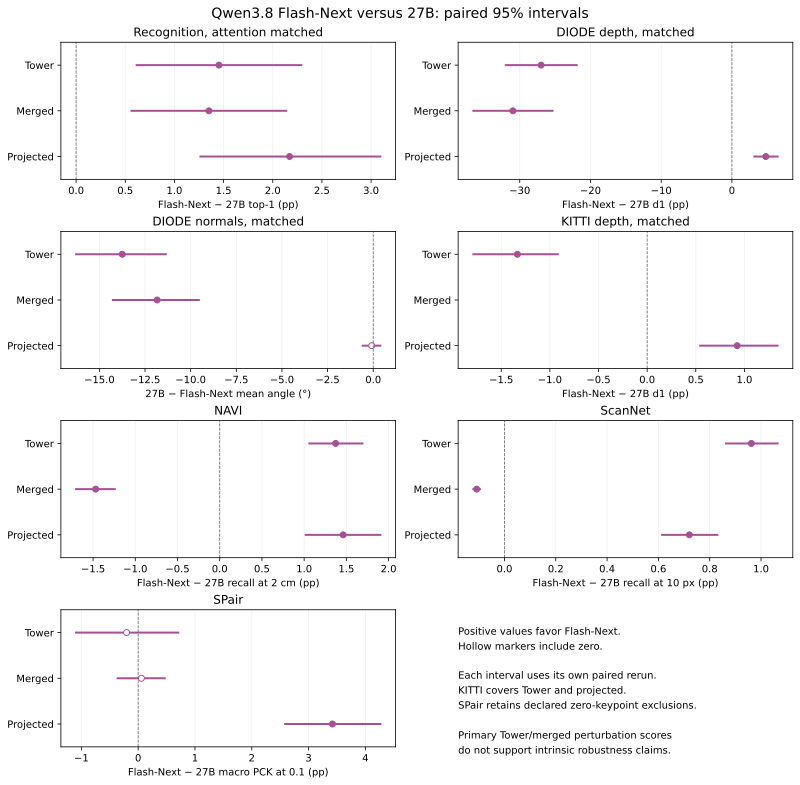

# Qwen3.8 Flash-Next measurements at 448 pixels

Flash-Next improves matched-attention recognition over fresh 27B controls at all three Stages. Its Tower and merged readouts are weaker on DIODE depth and normals. The projected Stage recovers DIODE performance, improves correspondence against the sibling, and leads on KITTI depth. These checkpoint measurements do not identify a training cause.

Tower and merged compare the same architecture with different weights. The projected comparison also changes output width from 5120 to 2560. The [source evidence](README.md) covers all 333 tensors, all 27 layers, positional embeddings, the Projector, and independent pinned-source forward parity. The immutable release is `immanuelpeter/Qwen3.8-Flash-Next-Vision@120ed5d5baf11cb478099350e94218ee3cbed3df`, under the source Qwen Community License 1.0.

## Fresh paired sibling comparisons

Each row uses points and a 95% interval from the same fresh paired run. Recognition uses matched attention. Depth and normals use the matched multiscale head. Percentage metrics and differences are in percentage points. Normals are in degrees, and their advantage is 27B minus Flash-Next error. All positive advantages favor Flash-Next. The [machine-readable summary](benchmark-summary.json) links every source and its SHA256.

| Task | Stage | Flash-Next | 27B | Flash-Next advantage [95% CI] |
|---|---|---:|---:|---:|
| Recognition accuracy | tower | 89.35 | 87.90 | +1.45 [+0.62, +2.29] |
| Recognition accuracy | merged | 88.80 | 87.45 | +1.35 [+0.56, +2.14] |
| Recognition accuracy | projected | 89.88 | 87.71 | +2.17 [+1.26, +3.09] |
| DIODE depth d1 | tower | 26.10 | 53.08 | -26.98 [-31.97, -21.95] |
| DIODE depth d1 | merged | 22.39 | 53.37 | -30.97 [-36.56, -25.36] |
| DIODE depth d1 | projected | 64.16 | 59.36 | +4.80 [+3.18, +6.46] |
| DIODE normal degrees | tower | 47.77 | 34.02 | -13.75 [-16.28, -11.36] |
| DIODE normal degrees | merged | 48.02 | 36.19 | -11.84 [-14.26, -9.55] |
| DIODE normal degrees | projected | 29.96 | 29.88 | -0.08 [-0.57, +0.39] |
| KITTI depth d1 | tower | 93.76 | 95.09 | -1.33 [-1.79, -0.92] |
| KITTI depth d1 | projected | 95.72 | 94.80 | +0.93 [+0.55, +1.34] |
| NAVI recall 2cm | tower | 39.20 | 37.83 | +1.37 [+1.06, +1.69] |
| NAVI recall 2cm | merged | 9.78 | 11.25 | -1.47 [-1.70, -1.24] |
| NAVI recall 2cm | projected | 41.21 | 39.74 | +1.46 [+1.02, +1.90] |
| ScanNet recall 10px | tower | 9.30 | 8.34 | +0.96 [+0.86, +1.06] |
| ScanNet recall 10px | merged | 0.15 | 0.26 | -0.11 [-0.12, -0.10] |
| ScanNet recall 10px | projected | 7.12 | 6.40 | +0.72 [+0.61, +0.83] |
| SPair class-macro PCK | tower | 30.62 | 30.82 | -0.20 [-1.09, +0.71] |
| SPair class-macro PCK | merged | 2.86 | 2.80 | +0.06 [-0.36, +0.47] |
| SPair class-macro PCK | projected | 36.48 | 33.06 | +3.42 [+2.59, +4.26] |

Within Flash-Next, the Projector recognition advantage over Tower is +0.67 points, with interval [-0.07, +1.42]. Its matched DIODE depth advantage is +36.77 points [31.59, 41.97], and its matched normal error is 17.19 degrees lower [14.85, 19.65]. Raw-arm, correspondence, perturbation, and KITTI Projector comparisons remain in `results/bootstrap/`. The SPair Projector comparison uses the existing micro-average protocol. The sibling table and figure use the separately recorded class-macro intervals.

## Complete primary coverage

The [requirement and content audit](requirement-content-audit.json) validates actual payloads against the pre-run [inventory](expected-inventory.json), source hashes, seeds, IDs, grids, and finite metrics. It checks all 153 planned artifacts: eight tensor caches and 145 measurement jobs. A job is not a measurement cell.

| Primary requirement | Actual coverage |
|---|---|
| Recognition | 40 cells: eight Tower depths plus merged and projected, attention and mean, raw and matched |
| DIODE geometry | 40 cells: the same ten slices, depth and normals, raw and matched |
| KITTI transfer column | Two matched depth cells, final Tower and projected |
| Label budgets | Eight cells: attention and mean at 1%, 5%, 20%, and 100% |
| Correspondence | Three Stages on each of NAVI, ScanNet, and SPair for both checkpoints |
| Perturbation | All 13 conditions at three Stages for both checkpoints, 78 condition cells |
| Throughput | 768 measured images, batch eight, two loaders, 448 pixels |
| Primary paired intervals | 33 records: recognition four, geometry ten, KITTI three, correspondence twelve, perturbation four |

Recognition uses all 13,000 prepared validation images, internally split into 9,100 training, 1,950 validation, and 1,950 test images. The labelled training budgets contain 100, 455, 1,820, and 9,100 images. Semantic extraction pools to 4 by 4 tokens. DIODE uses all 771 images with the authoritative 541/115/115 split. KITTI uses all 1,000 images with 700/150/150. Perturbations use 2,000 images with 1400/300/300. Exact IDs are retained in `splits.json` and `label-budget-splits.json`.

Geometry retains native 28 by 28 Tower grids and 14 by 14 Connector grids. Raw widths are 1152, 4608, and 2560. DIODE prepared maximum depth is 299.8 metres. KITTI uses 80 metres. Primary recognition searches eleven learning rates with seed 0 for 20 epochs. Geometry searches six with seed 0 for ten epochs. Both retrain the selected rate with seeds 0, 1, and 2. Primary matched reducers retain the prescribed mean-centred PCA.

Each checkpoint retains all 555 NAVI, 1,500 ScanNet, and 3,600 SPair selected IDs. SPair has exactly 192 source-verified pairs with zero jointly visible keypoints after the canonical crop, with explicit IDs and reasons in the exclusion reports. Every nonempty pair and every aggregate is finite. Paired SPair comparisons use the actual finite intersection of 3,408 pairs and report the 192-ID exclusion union. The two checkpoints have the same zero-keypoint IDs. No other nonfinite metrics receive an exemption.

## Reducer sensitivity is a separate diagnostic

Primary perturbation clean accuracy is 30.67%, 7.22%, and 87.11% at Flash-Next Tower, merged, and projected, versus 83.11%, 81.00%, and 85.22% for fresh 27B. The weak Flash-Next Tower and merged baselines do not support intrinsic robustness claims. Those primary measurements remain unchanged. Default robustness summaries omit the weak Tower claim, and neither weak Stage supports an intrinsic robustness conclusion.

The isolated [conditioning diagnostic](../../diagnostics/qwen38-flash-next-conditioning/README.md) adds 78 standardized condition cells, six raw seed-0 replays, six complete channel-statistic records, and four paired diagnostic intervals. Four standardized label-budget fractions also extend the existing diagnostic figure source additively. Both checkpoints use the same six-thread CPU protocol and prescribed search and training seeds. Means, sample standard deviations, and PCA fit only the training split. The recovered R2 patch hash is retained in the evidence.

Standardization recovers Flash-Next clean accuracy to 87.11%, 85.78%, and 86.33%. It changes both channel scaling and the retained PCA subspace, so these runs establish readout sensitivity without separating those effects. Channel concentration alone does not explain the failure: both raw Towers have a large first-component share. Weight drift does not prove reinitialization or a particular training history. A shared cause with MiMo remains untested.

## Execution, correction, and limits

CPU runs use AMD EPYC 9355 hardware. GPU runs use one NVIDIA RTX PRO 6000 Blackwell Server Edition under an exclusive physical-GPU lock. The first six mean cells predate the CPU cap and use ten threads. Later CPU jobs use six. Fresh paired comparisons use matching hardware and settings within each comparison. GPU probes use eight threads and at most two loaders. Matrix and paired reruns can differ numerically, particularly for CUDA geometry training, so interval points always come from their own paired records.

The attention phase completed 19 new GPU cells in 810.662 seconds. One full-label CPU attention cell is reused after an exact configuration and payload audit. The geometry and KITTI phase completed 55 numeric jobs in 11,480.282 wall seconds, with 11,299.308 worker seconds. The final nine CUDA jobs completed in 1,149.042 wall seconds, with 1,115.397 worker seconds. All successful numeric processes exited zero. The twelve final CPU correspondence bootstraps took 17.527 worker seconds. Detailed command, device, thread, source, input, output, and timestamp records are in `execution.jsonl.gz`.

The original geometry validator incorrectly expected 539 training and 117 test images. The numeric runner always used 541 and 115. The first primary geometry payload completed successfully but failed that validator. The [correction record](geometry-validator-correction.json) preserves the original failure and runner hash, changes validation to the authoritative split function and exact ID lists, and resumes without retraining any metric. Four prior bootstrap payloads are preserved. Focused regression tests cover all four dataset sizes.

Throughput is 129.19 images per second over 5.945 measured seconds. It includes preprocessing, transfer, Tower forward, and final Tower Stage materialization, with two warmup batches. Historical throughput runs can use different loader counts and hardware, so this is a hardware-specific measurement rather than a controlled sibling speed comparison. KITTI is one selected-depth transfer column, not a general driving evaluation. Confidence intervals condition on the prepared samples and seeded readout protocol. They do not quantify model-training uncertainty.

Historical cohorts and published sibling payloads remain intact. Fresh 27B correspondence and perturbation controls live under `controls/`. The full cache audit covers 684 BF16 tensor shards and 51,586,671,784 bytes. Cache files remain in the delivery environment. Committed manifests and hashes retain their provenance. All GPUs were released before final CPU postprocessing.

## Qwen checkpoint comparison

`qwen3_5` identifies Qwen3.8-27B. `qwen38_flash_next` identifies Qwen3.8
Flash-Next. Their Tower and merged widths are 1152 and 4608. Their Projector
outputs have widths 5120 and 2560, respectively. Tower and merged comparisons
change checkpoint weights. Projected comparisons also change output width.
Weight drift alone does not establish a training history or a reinitialization.

[Source and immutable release evidence](results/evidence/qwen38-flash-next/README.md)
records independent native forward parity and every tensor comparison. The
[isolated reducer diagnostic](results/diagnostics/qwen38-flash-next-conditioning/README.md)
recovers weak Flash-Next clean perturbation readouts with training-only channel
standardization before PCA. It establishes readout sensitivity. It does not
establish a checkpoint training cause or the same cause as MiMo's readout
failure. Primary Tower and merged perturbation measurements remain separate
and do not support intrinsic robustness claims given their low clean accuracy.
